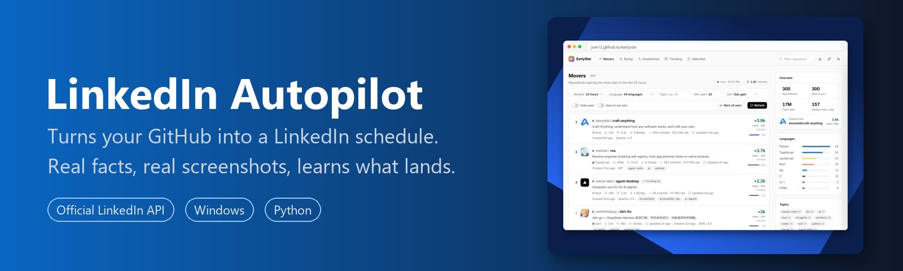
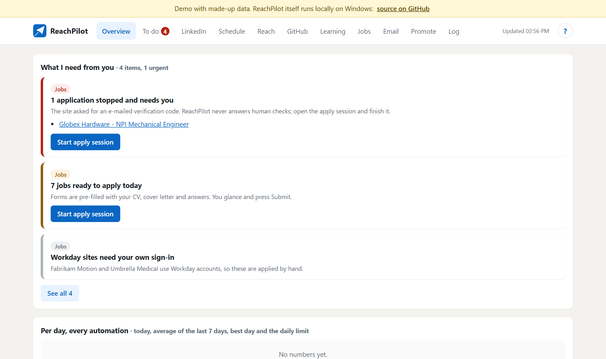

<p align="center">
  <a href="https://github.com/juw12/reachpilot"></a>
</p>

<p align="center">
  <b>Turns your GitHub into a LinkedIn schedule.</b><br>
  For developers who ship side projects but never get round to posting them. ReachPilot writes each post from
  your repo's real facts, adds a fresh screenshot, posts it through LinkedIn's official API and learns which projects people click.
</p>

<p align="center">
  <a href="https://github.com/juw12/reachpilot/actions/workflows/tests.yml"></a>
  
  
  
</p>

<p align="center"><a href="https://juw12.github.io/reachpilot/"><b>Try the live demo</b></a> (the real dashboard with made-up data)</p>

<p align="center"></p>

**Safe by design:** official Share on LinkedIn API only (no scraping, no browser bots, no auto-likes), every number in a
post must exist in your repo, and everything (tokens, history, drafts) stays on your PC in git-ignored files.

## Why

I build a lot of side projects. Writing a LinkedIn post for each one, finding a screenshot, picking a time, then doing
it again next week for the older ones: that's the part that never happens. ReachPilot does it for me, without making anything up.

## What it does

Every 30 minutes, Windows Task Scheduler runs one pass:

1. **Watches GitHub** through the `gh` CLI: new public repos, new releases, real commit activity.
2. **Picks what to post** in the next slot (Tue/Wed/Thu 08:00 by default), in this order:
   new repo → new release → your hand-written queue → active-repo update → top-performer roundup → an older project from a fresh angle.
3. **Writes the post from facts only**: README tagline and feature bullets, description, topics, commit messages.
   A guard rejects any number that isn't in the source. No invented users, stars or backstory.
4. **Adds real visuals**: a fresh screenshot of the live site (and the repo page), plus media from the README.
5. **Never repeats itself**: four angles (launch, one-feature deep dive, behind the build, ask for feedback),
   different README facts each time, a 21-day cooldown per project and a similarity cap against every past post.
   If nothing fresh qualifies, it skips the slot instead of reposting.
6. **Learns what lands**:
   - visitors GitHub attributes to linkedin.com / lnkd.in (repo traffic API),
   - stars gained in the week after a post,
   - "Try it" clicks: site links go through `<you>.github.io/go/<project>/`, a tiny page that counts the click with
     [GoatCounter](https://www.goatcounter.com) and forwards in well under a second.

   Projects and angles are then chosen with Thompson sampling: winners get posted more, untested ones still get a turn.

It also repairs garbled characters in READMEs (text saved in the wrong encoding), skips install/run steps when picking
feature bullets, and puts links in the first comment.

## What it deliberately doesn't do

- No browser automation, scraping, auto-likes or auto-comments on other people's posts. Only the official
  **Share on LinkedIn** API, so the account stays in good standing.
- No AI-invented claims. An optional local model (Ollama) can rephrase a post, but its output is rejected if it adds numbers.
- No silent failures: a LinkedIn login that is about to expire, a failed post or a draft waiting for review shows up
  on the dashboard's to-do list, and you get a Windows notification a week before the 60-day LinkedIn token runs out.

## Setup

You need Windows 10 or 11, Python 3.10+, Microsoft Edge (used for screenshots, so no browser download),
the [GitHub CLI](https://cli.github.com/) and a free LinkedIn developer app.

```powershell
git clone https://github.com/juw12/reachpilot; cd reachpilot
pip install -r requirements.txt
gh auth login                        # GitHub CLI: repos, READMEs and traffic
python autopilot.py init             # baseline your repos (+ optional seed_queue.json of hand-written posts)
python autopilot.py auth             # LinkedIn app with "Share on LinkedIn" + "Sign In with LinkedIn (OpenID)",
                                     # redirect URL http://localhost:8765/callback
python autopilot.py preview 5        # first result: the next 5 posts as drafts in drafts/, nothing is posted
python autopilot.py goatcounter      # optional: free GoatCounter site + token for "Try it" clicks
python autopilot.py install          # scheduled task \ReachPilot\LinkedIn posts: every 30 min + at sign-in
python selfupdate.py install         # optional: task \ReachPilot\Updates keeps the code current (fast-forward only)
```

Then edit `config.json`: your GitHub user, time zone, posting slots, weekly cap and excluded repos.
`"mode": "auto"` posts by itself; set `"mode": "review"` to hold each draft until you run `approve`.

## Everyday use

| Command | What it does |
|---|---|
| `dashboard` | opens the local app (127.0.0.1 only): to-do list, schedule with post previews, every post's reach, GitHub visitors, stars, "Try it" clicks, what the bot has learned, and the log. It closes itself after 15 idle minutes. |
| `status` | token expiry, queue, recent posts, best performers, click counts |
| `preview 5` | write the next 5 posts to `drafts/` without posting |
| `approve` | in review mode, approve the waiting draft |
| `uninstall` | remove the `\ReachPilot\LinkedIn posts` task |

**Pause:** create an empty file named `PAUSE` in the ReachPilot folder (or press Pause on the dashboard); delete it to resume.
**Remove completely:** `python autopilot.py uninstall`, then
`Unregister-ScheduledTask -TaskPath '\ReachPilot\' -TaskName Updates` if you installed the updater, and delete the folder.

### The dashboard as a hub

The dashboard can also show other outreach automations. Personal ones (for example a job search) live in `modules/`,
which is git-ignored and never committed; the dashboard only shows a module that exists on disk. Every job runs from
Task Scheduler under `\ReachPilot\`, dashboard actions are whitelisted and need a per-session token from the same origin,
and the `?` button explains per module when it runs, what it does by itself and what it needs from you.

## Files

| File | Role |
|---|---|
| `autopilot.py` | scheduler and commands |
| `composer.py` | post writing and the no-invented-facts guards |
| `github_source.py` | README and commit facts |
| `visuals.py` | screenshots (Edge, headless) |
| `linkedin_api.py` | OAuth, images, posts, comments |
| `analytics.py` | reach scoring |
| `trylinks.py` | tracked go-links |
| `dashboard.py` + `dashboard.html` | local dashboard (restarts itself onto new code) |
| `hub.py` | dashboard modules, to-do list and whitelisted actions |
| `selfupdate.py` | fast-forward updater used by the dashboard and the Updates task |
| `selftest.py` | tests (run in CI) |

## License

MIT License, © 2026 Juwen Lie.
